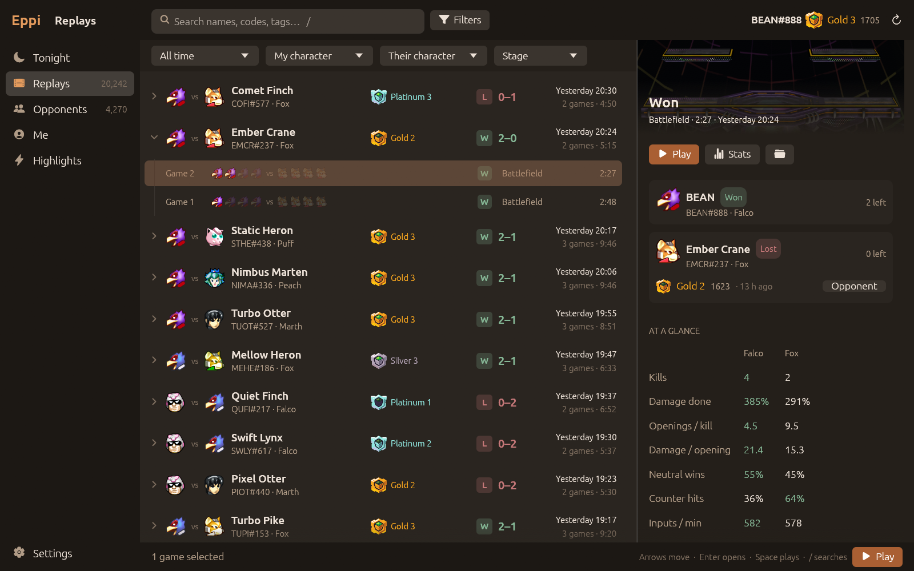
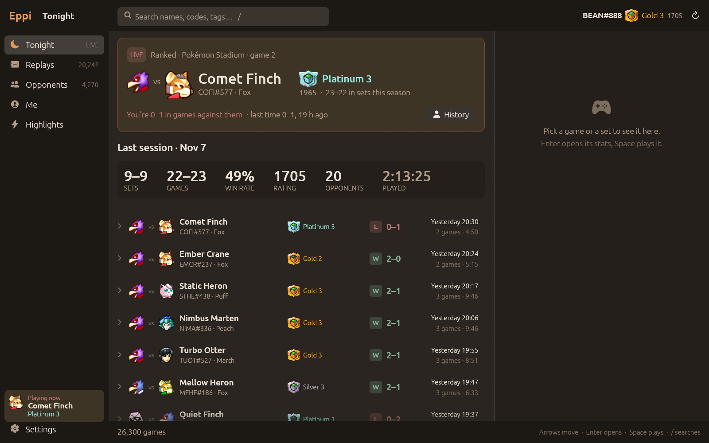
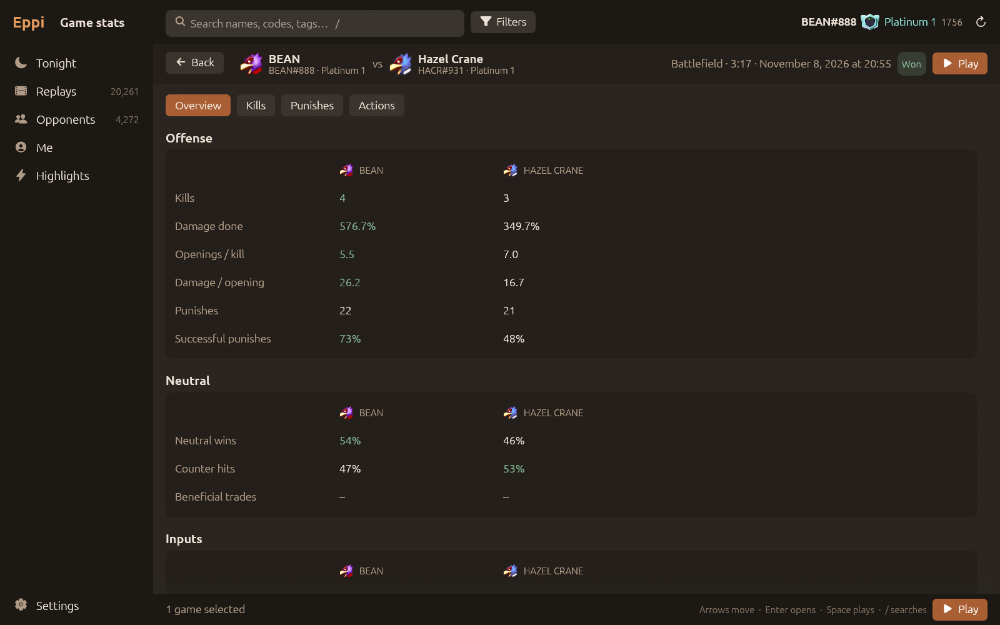
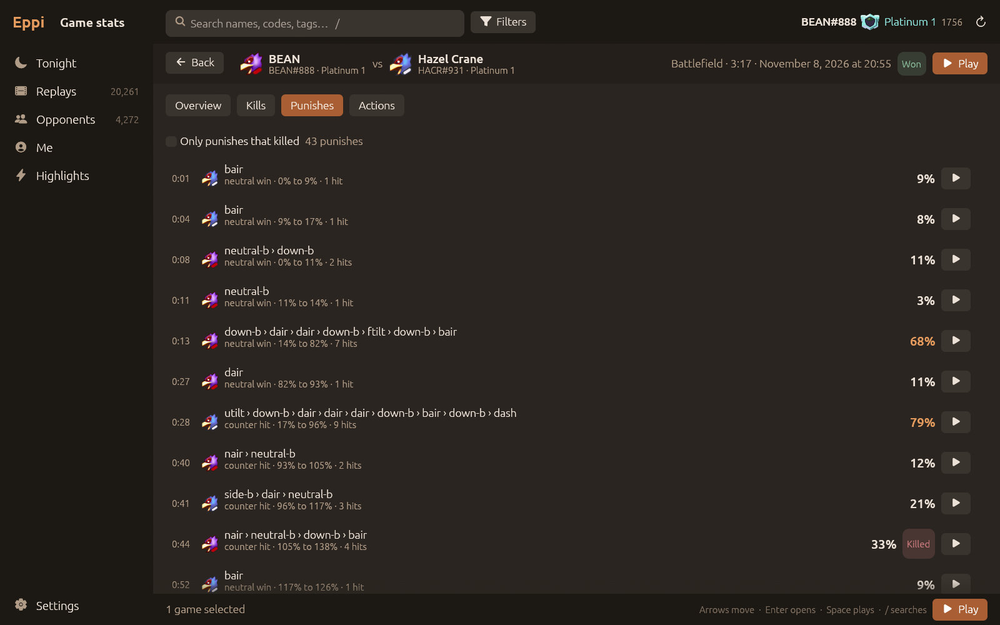
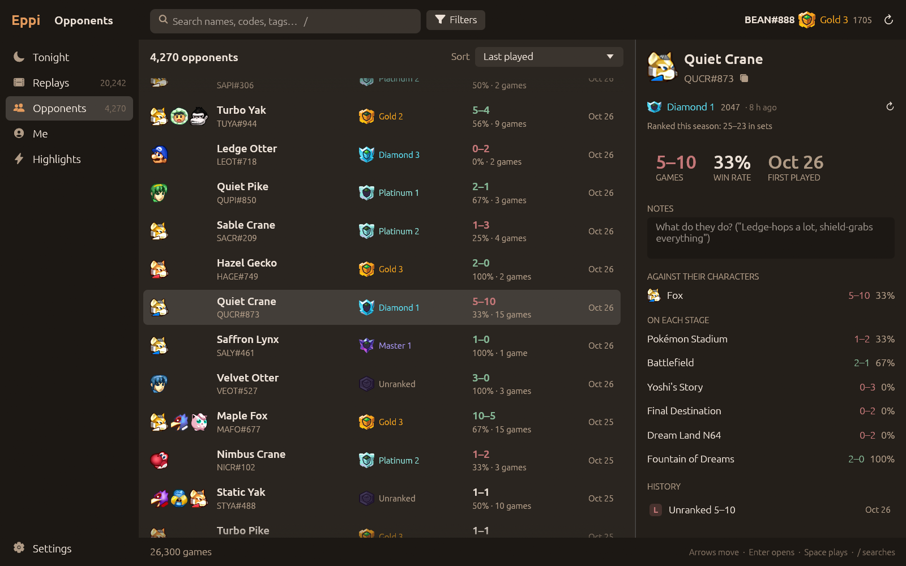
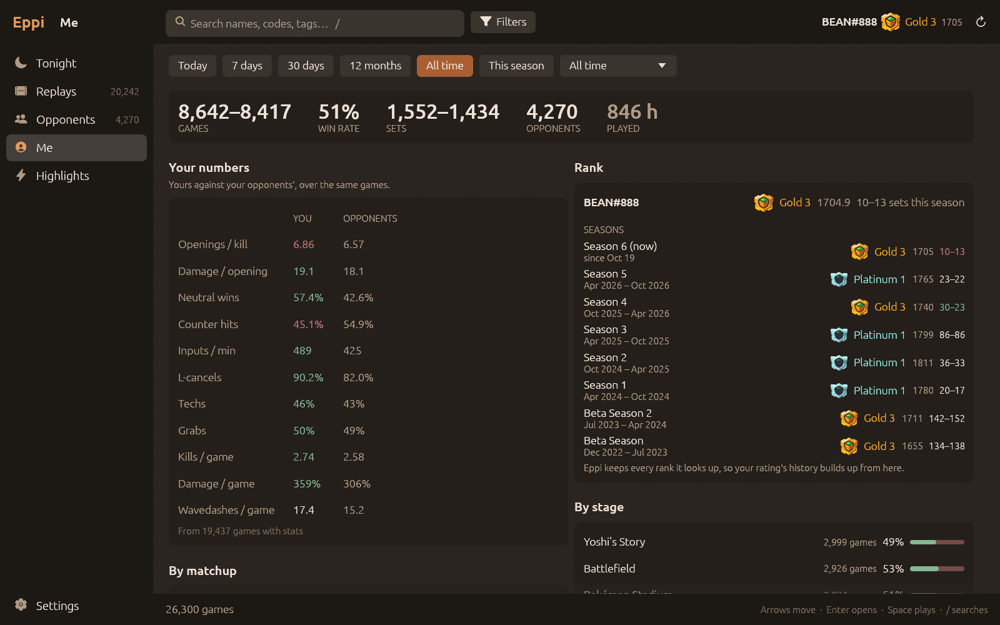
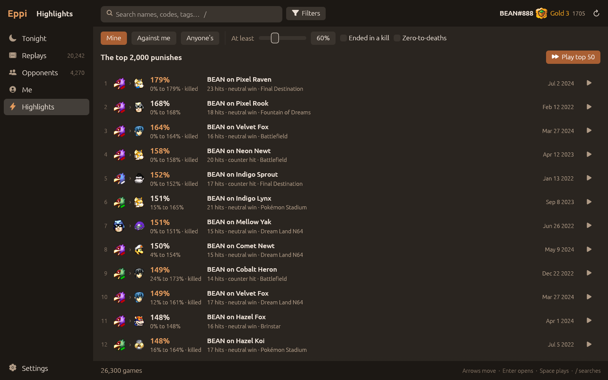
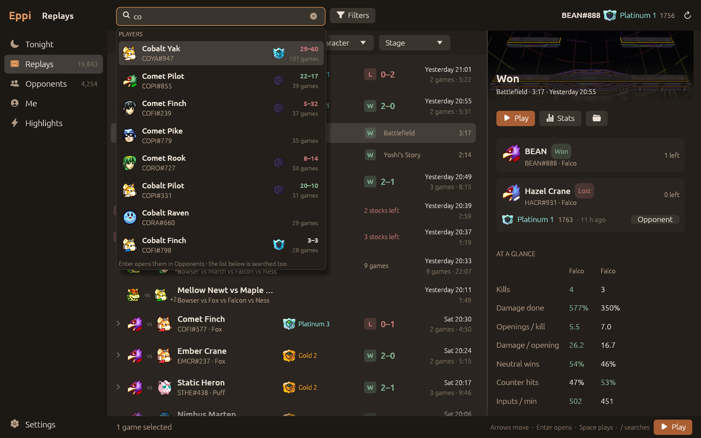
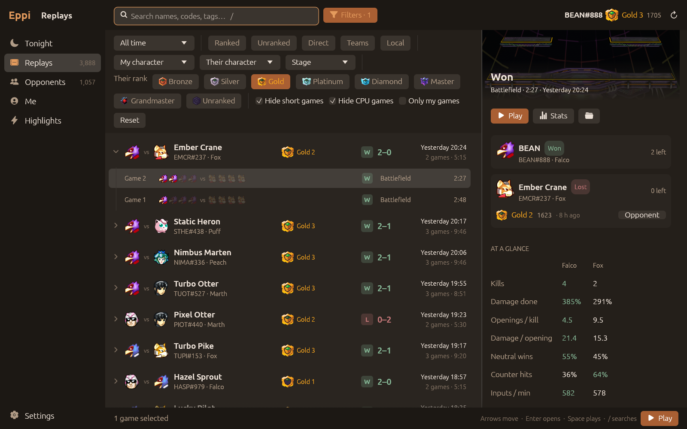

# Eppi

[](https://github.com/rj-jones/eppi/actions/workflows/rust.yml)
[](https://github.com/rj-jones/eppi/releases/latest)
[](LICENSE)

A fast desktop app for your [Slippi](https://slippi.gg/) replays: sets, stats, ranks and the people you play.



Eppi reads every replay in your Slippi folders once and keeps an index, so it never reads them all again: after that it opens straight to your games. It watches the folders while you play. When a game starts, it shows who you're playing, their rank and your record against them.

**[Download Eppi](https://github.com/rj-jones/eppi/releases/latest)** for Windows, macOS or Linux.

## What it does

- **Tonight.** The session you're in: sets and games won and lost, how far your rating moved, and the opponent you're playing right now. You also get a desktop notification when a game starts while Eppi is in the background.
- **Replays.** Every game, newest first. Ranked sets fold into one row with their score (2–1), and so do unranked sessions with the same person. Each row shows the opponent's rank. You can filter by mode, character, stage, date or ranked season, and by the rank your opponent had in the season you played them.
- **Search.** Find anyone by netplay name, connect code or in-game tag. Suggestions show their character, rank and your record against them.
- **Stats.** Each game's stats as Slippi Launcher shows them (Overview, Kills, Punishes, Actions). The numbers are worked out the way slippi-js does it and match it exactly on 8,634 of 8,635 real replays. You can play any kill or punish from that moment.
- **Play.** Play a game, a whole set, a kill or a punish in Slippi's playback Dolphin, which Eppi finds through Slippi Launcher.
- **Opponents.** Everyone you've played, with your record against them and their rank. For each one: how you do against each of their characters and on each stage, your history, and your notes.
- **Me.** Your record, your rank and how you finished every season, and your numbers next to your opponents' (openings per kill, damage per opening, neutral wins, L-cancels and more). Also your results by matchup, stage and character, a week-by-week table to see whether you're improving, and a matchup report: what kills you, what you kill with, and which openings pay off.
- **Highlights.** Search every punish you've landed (or taken) by damage, kills or zero-to-deaths, and watch the best ones back to back.

Everything works from the keyboard: arrows move, Enter opens, Space plays, `/` searches, Esc goes back, Ctrl+1–5 switch views and F5 looks for new replays.

## Screenshots

<table>
  <tr>
    <td width="50%"><br><b>Tonight.</b> Who you're playing right now, their rank and your history with them.</td>
    <td width="50%"><br><b>Stats.</b> Offense, neutral and inputs for both players.</td>
  </tr>
  <tr>
    <td><br><b>Punishes.</b> Every opening with its moves and damage, ready to play.</td>
    <td><br><b>Opponents.</b> Your record against everyone, and against each of their characters.</td>
  </tr>
  <tr>
    <td><br><b>Me.</b> Your numbers next to your opponents', and every season's finish.</td>
    <td><br><b>Highlights.</b> Your biggest punishes across every game.</td>
  </tr>
  <tr>
    <td><br><b>Search.</b> Players by name, code or tag.</td>
    <td><br><b>Filters.</b> Here, only games against opponents who were Gold that season.</td>
  </tr>
</table>

The screenshots use made-up names and codes for other players (`eppi --showcase`); the games and numbers are real.

## Install

Get the latest version from the [Releases page](https://github.com/rj-jones/eppi/releases/latest):

- **Windows** (10 or 11): `eppi-…-windows-x64.zip`. Unzip it anywhere and run `Eppi.exe`.
- **macOS** (11 or newer, Apple Silicon or Intel): `eppi-…-macos.zip`. Unzip it and move `Eppi.app` to Applications.
- **Linux** (x86-64, Ubuntu 22.04 or newer, or another distro with glibc 2.35+): `eppi-…-linux-x64.tar.gz`. Unpack it and run `./install.sh` inside to add Eppi to your app menu, or run `./eppi` as it is.

The downloads aren't signed with a paid certificate, so the first launch takes one extra step. On Windows, if SmartScreen says "Windows protected your PC", click **More info**, then **Run anyway**. On macOS, if it says it can't check Eppi for malware, open **System Settings > Privacy & Security** and click **Open Anyway**. Each release lists checksums, and `gh attestation verify <file> --repo rj-jones/eppi` proves a download was built by this repo's release workflow.

### Build it yourself

You need Rust 1.95 or newer. On Windows:

```powershell
pwsh -File scripts\install.ps1              # builds, copies to %LOCALAPPDATA%\Programs\Eppi, adds a Start menu entry
pwsh -File scripts\install.ps1 -Uninstall   # removes both
```

On macOS or Linux:

```sh
scripts/install.sh               # macOS: ~/Applications/Eppi.app; Linux: ~/.local/bin/eppi and an app menu entry
scripts/install.sh --uninstall   # removes them
```

Or run it from the repo with `cargo run --release`. To build with Rust 1.95 without changing your default toolchain, put `RUSTUP_TOOLCHAIN=1.95.0` in front of the command.

Windows is where Eppi is used day to day. macOS and Linux build and pass the tests, and Eppi has run on both, but playing replays in Dolphin there hasn't been tried yet.

## Using it

The first time it starts, Eppi takes your connect code and replay folder from Slippi Launcher. In Settings, add alt codes so their games count as yours, and add every folder that holds replays. Folders inside each other are read once, and a replay copied into several places counts once. The index lives in `%LOCALAPPDATA%\Eppi` on Windows, `~/Library/Application Support/eppi` on macOS and `~/.local/share/eppi` on Linux.

Ranks come from Slippi's servers: one request for up to 25 players, at most one a second. Each player is looked up at most once a day, or once a week if you haven't played them in a month. Filtering by rank looks up the seasons of only the opponents in the games your other filters keep, and a finished season only once. You can turn lookups off in Settings.

## How it's built

- `src/`: the app, in Rust with [egui](https://github.com/emilk/egui).
  - `library/` keeps a SQLite index in step with the replay folders on a worker thread. A first pass reads players and results without frames, so thousands of replays index in seconds. A second pass works out full stats in the background, newest games first.
  - `ui/` holds the views. The lists are virtual, so only the rows on screen are drawn.
- `crates/eppi-stats`: slippi-js's stats ported to Rust on [peppi](https://github.com/hohav/peppi). `tools/verify-stats` compares its output with slippi-js on real replays.
- `crates/eppi-rank`: rank and season lookups by connect code, using the API and the rank tiers Slippi Launcher uses. Its `RESEARCH.md` explains how the API behaves.

```sh
cargo test --workspace
cargo run --release -- --showcase docs/screenshots   # the screenshots above, then quits
```

## Contributing

Bug reports and ideas go in [Issues](https://github.com/rj-jones/eppi/issues). To work on the code, see [CONTRIBUTING.md](CONTRIBUTING.md). To report a security problem privately, see [SECURITY.md](SECURITY.md). [CHANGELOG.md](CHANGELOG.md) lists what changed in each release.

## Credits

Replays are read with [peppi](https://github.com/hohav/peppi), and the stats are a port of [slippi-js](https://github.com/project-slippi/slippi-js). The rank tiers follow [Slippi Launcher](https://github.com/project-slippi/slippi-launcher), which is also where the character, stage and rank art and the app icon come from. Icons are [Ionicons](https://ionic.io/ionicons), and the heading font is Ubuntu. [assets/README.md](assets/README.md) lists every asset's source and terms.

Eppi isn't affiliated with or endorsed by Project Slippi or Nintendo. *Super Smash Bros. Melee* and its characters are Nintendo's.

## Licence

Eppi is free software under the [GNU General Public License v3.0 or later](LICENSE). `crates/eppi-stats`, the port of slippi-js, is under the [GNU Lesser General Public License v3.0 or later](crates/eppi-stats/COPYING.LESSER), the same as slippi-js. The art in `assets/` isn't covered by either; see [assets/README.md](assets/README.md).

Versions before 1.0.0 were released under MIT or Apache-2.0.
